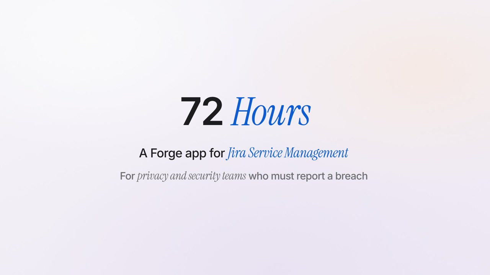
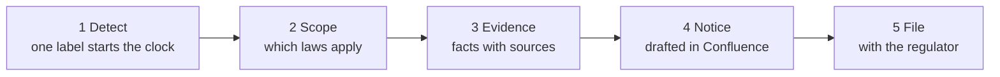
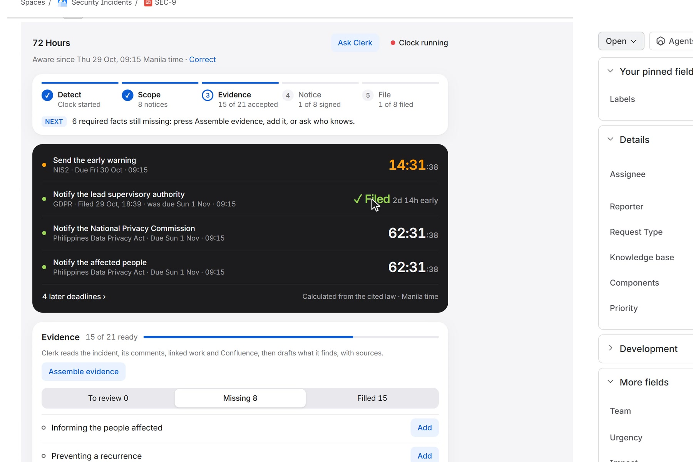
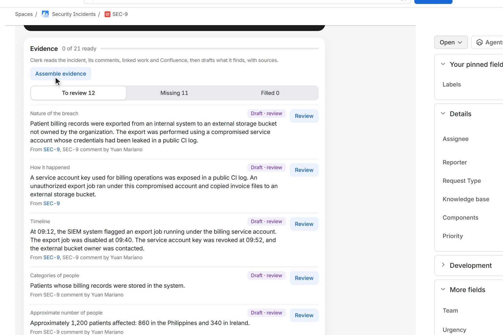
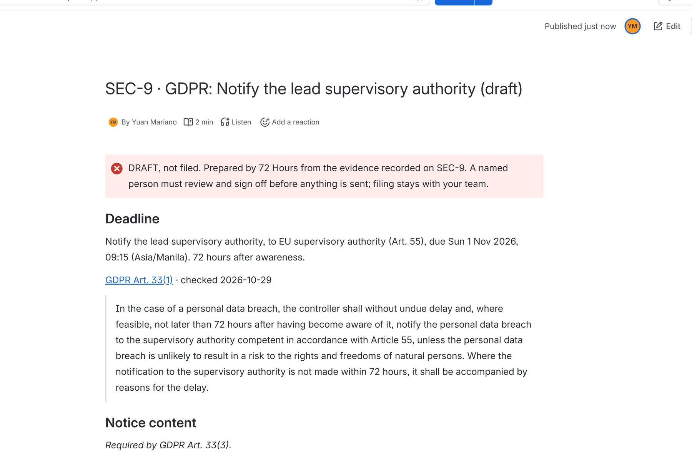
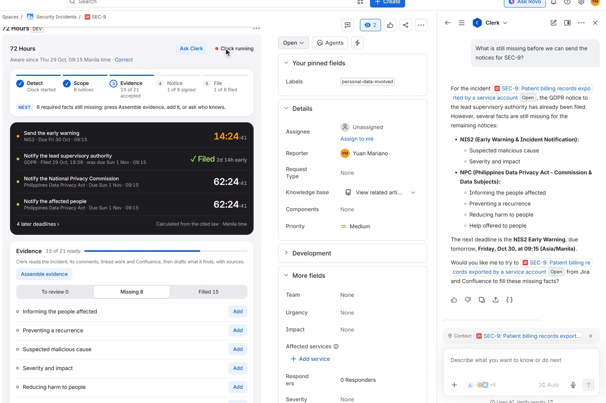
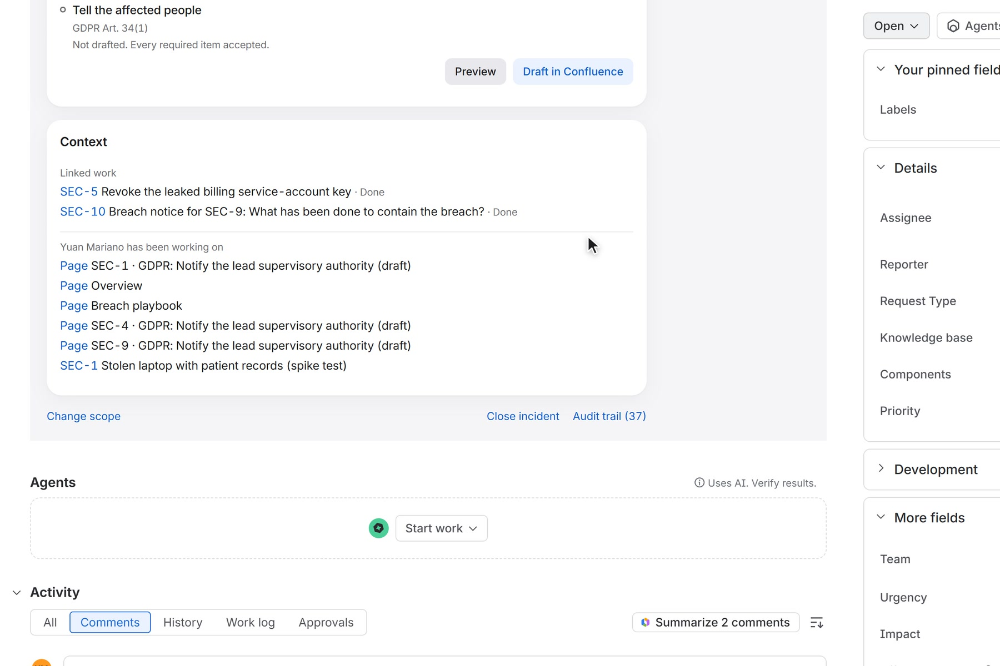
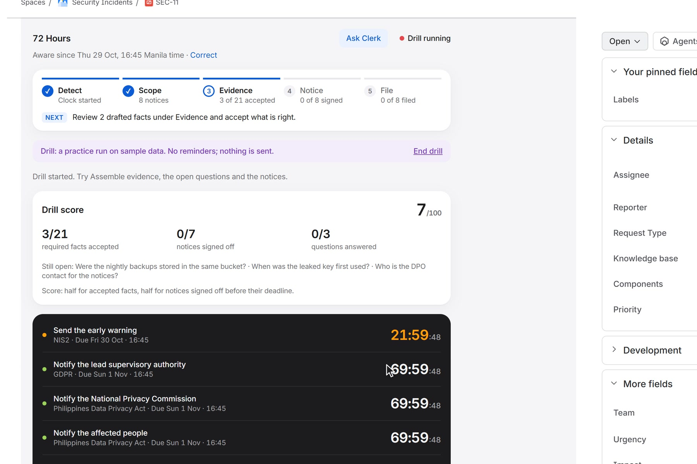

# 72 Hours

**Breach-notification deadlines in Jira Service Management: every legal clock calculated from the cited law, the facts gathered with sources, notices drafted in Confluence, and people sign off.**

[](https://developer.atlassian.com/platform/forge/)
[](https://www.atlassian.com/software/jira/service-management)
[](https://www.atlassian.com/software/rovo)
[](https://developer.atlassian.com/platform/teamwork-graph/)
[](https://go.atlassian.com/runs-on-atlassian)
[](#tests)
[](https://youtu.be/YZc4jvTdKvk)
[](https://codegeist2026.devpost.com/)

**Codegeist 2026** submission (Oct 27 – Dec 22, 2026), category **Apps for Specialized Industries**, built solo by
[Yuan Andrei Mariano](https://github.com/yuan05-afk). Entered for the **Best Marketplace published app** bonus prize, and
built with a Rovo agent, Atlassian MCP and Teamwork Graph. [Devpost project page](https://devpost.com/software/72-hours-breach-notification-for-jira-service-management).

<p align="center">
  <a href="https://youtu.be/YZc4jvTdKvk"></a>
</p>
<p align="center"><sub>Watch the 2:38 demo: <a href="https://youtu.be/YZc4jvTdKvk">youtu.be/YZc4jvTdKvk</a> (English subtitles)</sub></p>

---

## Overview

When personal data leaks, the law starts a clock. Under **GDPR** the regulator must hear from you within **72 hours**.
The **Philippine Data Privacy Act** also gives 72. **NIS2** wants an early warning in **24**. HIPAA, SEC 8-K and
Singapore's PDPA run clocks of their own, each counted differently: hours, calendar days, US business days, months.

Each regulator also wants specific facts: what happened, whose data, how many people, what you have done about it. On
day one those facts are scattered across tickets, comments, Confluence pages and people's heads. Teams lose the first
day finding them.

**72 Hours** is a Forge app for **Jira Service Management**, built for the **privacy, security and IT teams who have to
report a breach**. It works in five steps, shown as a strip at the top of its panel with the one thing to do next:



| Step | What happens |
| --- | --- |
| **1 Detect** | Add the label `personal-data-involved` (or press **Start breach clock**). The awareness time is recorded at once and an internal note asks the team to confirm it. |
| **2 Scope** | A few rough answers (data types, where people live, how many, how serious) decide which laws apply, with a live preview. Every deadline lands on one board, counting down. Open one to read the law's own words and article. |
| **3 Evidence** | **Assemble evidence**: Clerk (Claude, hosted by Atlassian) reads the incident, its comments, linked work, Confluence pages and Teamwork Graph context, and drafts each fact the regulators need **with its source**. A person accepts every draft. Unknowns become questions with an owner, then Jira tasks; the answer left on the task flows back as a draft. |
| **4 Notice** | Each regulator's notice is drafted in Confluence: marked DRAFT, with sources, gaps and assumptions. **Sign off** unlocks only when every required fact is accepted. |
| **5 File** | The team files with the regulator and records it. That clock stops on the board (showing how early it was filed), its reminders end, and the audit trail keeps who did what, and when. |

> Deadlines calculated by code. Drafts written by AI. Decisions made by people.

---

## What makes this different

### 1. Deadlines are code, not a model's guess

The rulebook (`src/rules/`) covers **7 regimes and 19 notification stages** (GDPR, UK GDPR, Philippine NPC, NIS2, HIPAA,
SEC 8-K Item 1.05, Singapore PDPA). Every stage carries a **verbatim quote** of the primary source, its URL and a
last-checked date. The engine handles exact hours, local calendar days, US business days with federal holidays,
month-end clamping, time zones and daylight-saving changes. Where the law can be read two ways it takes the **earliest**
deadline and shows the assumption. AI never touches a deadline. See [docs/RULEBOOK.md](docs/RULEBOOK.md).

### 2. AI drafts, with sources, and a person decides

Clerk gets numbered sources and must cite them. Its JSON is validated; anything uncited or unrequested is dropped; it
never overwrites a person's value; if the model is unavailable the app falls back to facts it already holds. Every
draft is marked for review until someone accepts it. Sign-off is blocked until every required fact is accepted.

### 3. The work already in Atlassian becomes the notice

Evidence comes from the incident, its comments and links, the Confluence breach playbook and **Teamwork Graph** (what
the people on the incident have been working on). Missing facts become **Jira tasks** for the person who knows, and their
answer comes back on its own. The notice is written in **Confluence**, where the team already reviews documents.

### 4. Private by design

Runs on Atlassian: no remote backend, no egress. Data stays in **Forge SQL**; the model is **Atlassian-hosted**. Every
app comment on a JSM request is an **internal note** customers never see. Rovo and MCP actions check that the caller
can see the issue. The Teamwork Graph connector publishes **status only, never breach facts**, visible only to the people
on that incident.

---

## How it meets the Codegeist judging criteria

| Criterion | Evidence in this repo |
| --- | --- |
| **Technological implementation** | 8 Forge capabilities in one app: `jira:issuePanel` (Custom UI), product-event `trigger`, `scheduledTrigger`, `rovo:agent` + 5 actions, `rovo:mcp`, `graph:connector`, `llm` (Forge LLMs) and Forge SQL with migrations. 107 automated tests. `asUser()` for every user action. |
| **Design** | A complete product, not a proof of concept: a five-step progress strip with the next action, light and dark Jira themes, keyboard-only and WCAG AA contrast checked, internal notes, reminders, an audit trail, a practice drill, and a post-incident summary. Design system in [docs/DESIGN.md](docs/DESIGN.md). |
| **Potential impact** | A real legal deadline (72 hours) for a real audience (privacy, security and IT teams). The demo runs a realistic patient-records breach end to end, from label to filed notice, with the GDPR notice filed 2 days 14 hours early. |
| **Innovation** | Cited, tested legal deadlines combined with source-cited AI drafting and human sign-off, across Jira, Confluence, Rovo, MCP and Teamwork Graph. Deadlines are never generated by AI. |
| **Presentation** | A 2:38 demo that states the problem, the audience and the five steps, all on live 2x footage of the app: [youtu.be/YZc4jvTdKvk](https://youtu.be/YZc4jvTdKvk). |

### Bonus prize integrations

| Bonus | What the app does |
| --- | --- |
| **Rovo agent** | **Clerk** (`rovo:agent`, 5 actions): what is still missing per notice, running breaches, add an open question, draft notice text, assemble cited evidence. Always with the caller's own Jira permissions. Opens from the panel's **Ask Clerk** button. |
| **Atlassian MCP** | The same actions as a `rovo:mcp` server: list breach incidents, get notification status, add an open question, draft notice text. Usable from Rovo Studio agents and any MCP client. |
| **Teamwork Graph** | **Read:** a persisted Cypher query finds pages and work items by the people on the incident (panel **Context** and evidence sources). **Write:** a `graph:connector` publishes each notice's status as `atlassian:document` objects with replicated permissions. |
| **Marketplace** | A Jira-only edition, *72 Hours: Breach Notification Deadlines*, is submitted for listing on the Atlassian Marketplace (free). It implements Atlassian's personal data reporting API. |

---

## Screenshots

Live captures from the app running on a Jira Service Management test site (sample incident data).

<table>
<tr>
<td width="50%" valign="top">
<strong>1. Deadline board and the five steps</strong><br/>
<br/>
<sub>One clock per law, counting down; a filed notice stops and shows how early it was filed.</sub>
</td>
<td width="50%" valign="top">
<strong>2. Evidence with sources</strong><br/>
<br/>
<sub>Clerk drafts each fact with its source; a person accepts each one.</sub>
</td>
</tr>
<tr>
<td width="50%" valign="top">
<strong>3. The notice in Confluence</strong><br/>
<br/>
<sub>Marked DRAFT, with the deadline, the law's words, sources and gaps.</sub>
</td>
<td width="50%" valign="top">
<strong>4. Clerk in Rovo</strong><br/>
<br/>
<sub>"What is still missing?", answered from live data.</sub>
</td>
</tr>
<tr>
<td width="50%" valign="top">
<strong>5. Teamwork Graph context</strong><br/>
<br/>
<sub>Linked work and what the people on the incident have been working on.</sub>
</td>
<td width="50%" valign="top">
<strong>6. Practice drill</strong><br/>
<br/>
<sub>Rehearse on sample data, with a readiness score.</sub>
</td>
</tr>
</table>

More: dark theme captures in [docs/screenshots](docs/screenshots).

---

## Try it

- **Judges:** the installation link and step-by-step testing instructions are in the
  [Devpost submission](https://devpost.com/software/72-hours-breach-notification-for-jira-service-management). The fastest
  tour takes about 3 minutes: open any issue, click the **72 Hours** icon, then **Try a sample breach**.
- **Everyone else:** the Marketplace edition will be installable from the Atlassian Marketplace once approved.
- **User guide:** [docs/USER-GUIDE.md](docs/USER-GUIDE.md).

Requirements: an Atlassian Cloud site with Jira Service Management (plain Jira also works) and Confluence. Rovo must be
on for the Clerk agent and MCP tools. No API keys, no external accounts, no configuration.

---

## Architecture

```
manifest.yml        jira:issuePanel (Custom UI), trigger x2 (issue created / updated), scheduledTrigger (hourly reminders),
                    rovo:agent "Clerk" + 5 actions, rovo:mcp, graph:connector, llm (Claude via Forge LLMs), sql
src/rules/          rulebook data (verbatim citations) + deterministic deadline engine (pure TypeScript, luxon)
src/notice/         what each regulator's notice must contain + the Confluence draft composer
src/service/        incidents, evidence and questions, notices, assemble (LLM), detection, reminders, drill and summary
src/jira/           ports and @forge/api clients: Jira, Confluence, Teamwork Graph, Forge LLM
src/store/          Forge SQL store with migrations, and an in-memory store for tests
src/rovo.ts         Clerk actions = MCP tools
src/connector.ts    Teamwork Graph connector
static/panel/       React + Vite Custom UI that follows Jira's light and dark themes
```

| Layer | Stack |
| --- | --- |
| Platform | Atlassian Forge, Runs on Atlassian (no remotes, no egress) |
| Products | Jira Service Management, Jira, Confluence, Rovo, Atlassian MCP, Teamwork Graph |
| Backend | TypeScript, Forge SQL, Forge LLMs (Claude Haiku 4.5, hosted by Atlassian), luxon |
| Frontend | React 18, Vite, Atlassian Design System tokens |
| Tests | Vitest (107 tests) |

### Security and privacy

- **No secrets:** the app holds no API keys or tokens; Forge handles authentication.
- **Least privilege:** every scope in `manifest.yml` is commented with why it is needed.
- **Permissions:** user actions use `asUser()`, so Jira's own permissions apply. `asApp()` is used only in event and
  scheduled triggers where no user is present (detection, reminders, reading a finished task's answer).
- **Input handling:** length limits and allow-lists on every input, bound parameters in all SQL, React escaping in the UI.
- **Comments:** every app comment on a JSM request carries the internal-note property; the app checks it came back
  internal.
- **Data:** stored in Forge SQL inside Atlassian, following the site's data residency. Privacy policy:
  [docs/PRIVACY.md](docs/PRIVACY.md). Terms: [docs/TERMS.md](docs/TERMS.md).

---

## Run it locally

```powershell
git clone https://github.com/yuan05-afk/72hours.git
cd 72hours
npm install
npm test                       # 107 tests: rulebook, services, Rovo authorisation, model-output validation
npm run typecheck
cd static/panel; npm install; npm run build; cd ../..
```

Deploying requires your own Forge app registration: run `forge register` (it replaces the app ID in `manifest.yml`), then
`forge deploy` and `forge install`.

Design preview without Jira:

```powershell
cd static/panel
npm run preview:fixture
npm run preview:build
npx vite preview --config vite.preview.config.js   # open ?state=running|detected|none&theme=light|dark
```

<a id="tests"></a>
### Tests

107 tests across the rulebook (time zones, DST, US federal holidays, month-end clamping), incident, evidence, notice and
reminder services, detection and task answers, model-output validation, Rovo authorisation, the progress strip and the
filed-clock display.

---

## Build log

Built solo during the Codegeist 2026 submission period. Development ran in local folders and was published to GitHub at
the end of the first build, so this repository's history starts with a single commit; later changes are committed as
they happen. The milestones, from the project's dated progress notes:

| Date | Milestone | Tests |
| --- | --- | ---: |
| Oct 29, 2026 | Idea and plan; one-day spikes proving each Forge capability (Custom UI, JSM panel, Forge SQL, Forge LLMs, Rovo agent, MCP, Teamwork Graph read, graph connector) | |
| Oct 29 | App registered. Rulebook v1: 7 regimes, 19 stages, verbatim citations, counting engine (time zones, DST, US holidays, month-end) | 27 |
| Oct 29 | Panel mockups designed and reviewed (light and dark); Forge SQL schema, incident service, append-only audit trail | 38 |
| Oct 29 | Detection by label with an internal note; notice field catalogue per regulator; evidence board and open questions; question to Jira task; hourly reminders. Live-verified on a JSM site | 72 |
| Oct 29 | The issue panel: deadline board with live countdown, scoping check with preview, evidence, questions, audit trail | 75 |
| Oct 29 | Notices in Confluence with gated sign-off and filing; Assemble evidence with Forge LLMs and citations; Teamwork Graph read and connector; Clerk Rovo agent and MCP tools; practice drill and post-incident summary | 94 |
| Oct 29 | Production deploy; connector connected; MCP tools verified in Rovo Studio; notice checklists for GDPR Art. 34, NPC, HIPAA, SEC 8-K; dark theme, keyboard and contrast checks | 95 |
| Oct 30 | Five-step progress strip, live refresh on issue changes, answers taken from a finished task's comment, filed notices stop their clock; demo film v2 published | 107 |
| Oct 30 | Privacy policy, terms and user guide published; installation link on; Jira-only edition with the personal data reporting API submitted to the Atlassian Marketplace | 107 |
| Oct 30 | Submitted to Codegeist 2026 on Devpost (Apps for Specialized Industries; Best Marketplace published app bonus) | 107 |

---

## Docs in this repo

- [docs/RULEBOOK.md](docs/RULEBOOK.md): every regime and stage, with the cited article and counting rule
- [docs/DESIGN.md](docs/DESIGN.md): the panel's design system
- [docs/USER-GUIDE.md](docs/USER-GUIDE.md): how to use the app
- [docs/VIDEO-SCRIPT.md](docs/VIDEO-SCRIPT.md) and [docs/video/NOTE.md](docs/video/NOTE.md): the demo's script, and what in it is live footage versus designed
- [docs/PRIVACY.md](docs/PRIVACY.md), [docs/TERMS.md](docs/TERMS.md)

---

## What's next

1. Notice checklists for the remaining stages (HIPAA notice to HHS, Singapore PDPA).
2. DORA for financial entities.
3. Counsel-editable rule overrides kept in Confluence.
4. Marketplace approval of the Jira-only edition, then a Confluence-enabled edition.

---

**Not legal advice.** 72 Hours calculates deadlines from cited rules and drafts documents; your DPO and counsel decide
what to notify and file.

© 2026 Yuan Andrei Mariano. All rights reserved. The source is published for review (Codegeist 2026 judging); no licence
to reuse it is granted.

_Evidence of outcome: watch the [demo](https://youtu.be/YZc4jvTdKvk), then open [the deadline board](docs/devpost/1-deadline-board.jpg) and find the GDPR notice: filed 2 days 14 hours before its 72-hour deadline._
